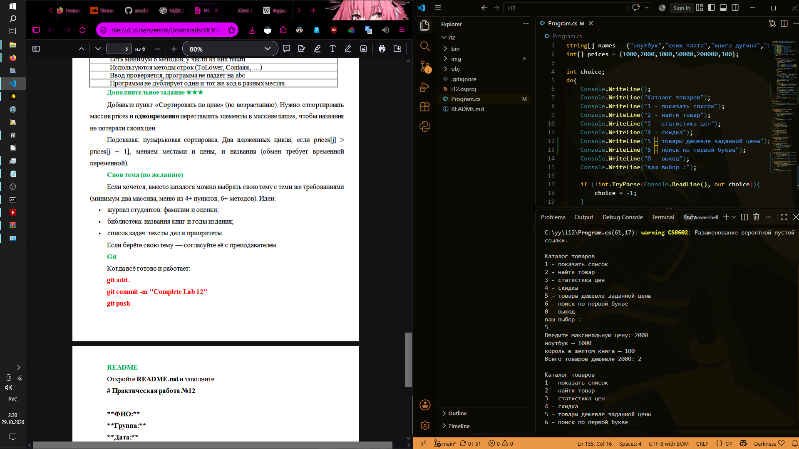
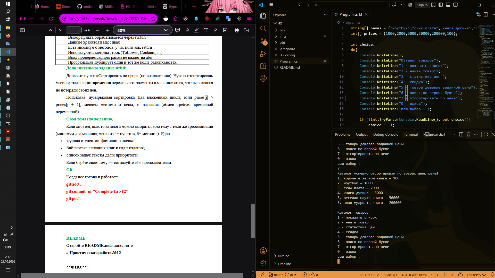

# ISRPO 12

**ФИО:** Чумаченко Михаил
**Группа:** ИСП-242

## Что изучено
- **Конструкции ветвления и циклов:** Применил циклы `do while` для создания непрерывного меню программы и оператор `switch` для обработки выбора пользователя, а также реализовал безопасный ввод данных с помощью `int.TryParse`.
- **Работа с массивами и строками:** Использовал параллельные массивы для одновременного хранения и обработки названий товаров и их цен, а также методы строк (`ToLower()`, `Contains()`) для реализации регистранезависимого поиска по каталогу.
- **Декомпозиция кода с помощью методов:** Разделил логику программы на отдельные функции (вывод списка, поиск, расчёт статистических показателей `MinPrice`, `MaxPrice`, `AveragePrice`), научившись передавать массивы в качестве параметров и возвращать вычисленные значения.

## Скриншоты

